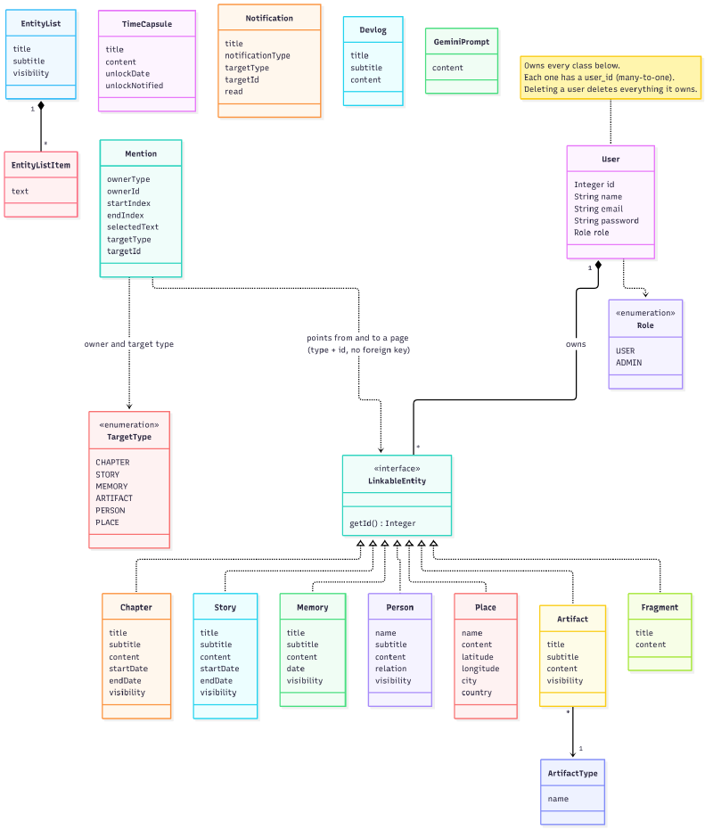

# Atlas

**Atlas** is a personal memory and life-organisation application. It helps users collect, connect and explore the important moments of their lives, like a small, private encyclopedia of their own life.

Instead of treating memories as isolated entries, Atlas is built around the idea that a life is made up of **people, places, events and experiences that are connected to one another**. A user writes pages (memories, chapters, stories, people, places, objects), highlights text in a page and links it to another page. Every page can then show what links to it (backlinks).

This repository contains the **backend API**.

---

## Documentation

| Document | What it contains |
|---|---|
| [User stories](documents/user-stories.md) | All 13 user stories with acceptance criteria and where in the code each one lives |
| [Full API documentation](documents/documentation.md) | Every endpoint in detail |
| [Class diagram](documents/class-diagram.md) | The domain model: the entities and how they relate |
| [Gherkin scenarios](documents/gherkin.md) | API behaviour written as Given / When / Then |

---

## Status

Atlas is under active development. The API is feature-complete for the core idea; some of the originally planned features are still future work.

| Area | Status |
|---|---|
| Registration, login (JWT), roles (`USER`, `ADMIN`) | Done |
| Chapters, stories, memories, fragments | Done |
| People, places | Done |
| Artifacts (physical objects) with user-defined categories | Done |
| Lists | Done |
| Time capsules (content hidden until the unlock date) | Done |
| Mentions: highlight text and link to another page, plus backlinks | Done |
| Devlog: a changelog written by admins and readable by everyone | Done |
| Notifications, created by the system and pushed live over a WebSocket | Done |
| Background jobs: time capsule unlock check, heartbeat, devlog fan-out | Done |
| AI journaling prompts (Google Gemini), rate limited | Done |
| Search across all pages | Planned |
| Timeline | Planned |
| Images on pages | Planned |
| Friends and sharing (`Visibility.PUBLIC` is stored but not used yet) | Planned |
| Themes and language support | Planned (frontend) |

---

## Technologies

**Backend**

- Java 25, Maven
- [Javalin 6](https://javalin.io/) (HTTP server, routing and WebSockets, on Jetty)
- Hibernate 7 / JPA with HikariCP
- PostgreSQL
- JWT (HS256) with Nimbus JOSE, passwords hashed with BCrypt
- Jackson (JSON), Lombok, SLF4J + Logback
- `java.util.concurrent` (scheduled and pooled background work, thread-safe collections)

**Tests**

- JUnit, Hamcrest, REST Assured
- Testcontainers (a real PostgreSQL 16 in Docker), so **Docker must be running** when you run the tests
- `java.net.http.WebSocket` client for the WebSocket tests

**External services**

- Google Gemini API (optional, only for `POST /api/gemini-prompts/generate`)

---

## Architecture

A request passes through these layers:

```
Client -> SecurityFilter (JWT, role) -> Controller -> Service -> DAO -> PostgreSQL
                                           |            |
                                        DTOs        Mapper (DTO <-> entity)
```

- **Controllers** parse and validate the request and choose the HTTP status. Most extend `AbstractController`, which implements the shared CRUD flow.
- **Services** contain the rules: ownership checks, category lookup, rate limiting.
- **DAOs** talk to the database. `GenericDAO` gives every entity create/read/update/delete. `UserOwnedDAO` adds queries filtered by user.
- **Mappers and DTOs** keep the database entities out of the API.
- **Errors** are thrown as `ApiException` and turned into JSON by the global handlers in `ApplicationConfig`. Server errors (`5xx`) are logged with a stack trace.
- **Dependencies** are wired by hand in `ApplicationConfig` (constructor injection).

### Background work and real-time notifications

Atlas does some work outside the request/response cycle:

```
 request thread (Jetty)             background threads
 ──────────────────────             ───────────────────────────────────────
 POST /api/devlogs (admin)  ──►     ExecutorService (2 threads)
   saves the devlog                   notifyAllUsers: one Notification per user
   returns 201 at once                        │
                                              ▼
 NotificationScheduler               NotificationService.sendNotification
 (1 thread, scheduled)                 1. save the Notification in the database
   every minute: unlocked    ──►       2. push it to the user's open WebSocket(s)
   time capsules get a
   notification
   every 20 seconds: ping
   all WebSocket connections
```

- **`ExecutorService`** (fixed pool of 2) creates devlog notifications for all users, so the admin does not wait for the whole fan-out.
- **`ScheduledExecutorService`** (single thread) runs two jobs: the time capsule check (every minute) and the WebSocket heartbeat (every 20 seconds). The `unlockNotified` flag on a capsule makes sure each capsule only notifies once.
- **`ConnectionRegistry`** remembers the open WebSocket connections per user. It uses a `ConcurrentHashMap` of thread-safe sets, and writes to a connection are `synchronized`, because Jetty does not allow two threads to write to the same connection at once.
- Both pools are shut down when the server stops.

### Domain model

A simplified class diagram. Every entity belongs to one user. Mentions point at pages by **type and id**, without foreign keys. See [the class diagram document](documents/class-diagram.md) for an explanation.




### Project structure

```
src/main/java/app
  config/        Javalin setup, Hibernate setup, dependency wiring
  controllers/   HTTP endpoints (+ generics/AbstractController) and the WebSocket endpoint
  services/      Business rules
  daos/          Database access (+ generics/GenericDAO, UserOwnedDAO)
  entities/      JPA entities
  dtos/          Request and response objects
  mappers/       Entity <-> DTO
  enums/         Role, Visibility, TargetType, NotificationType, Relation
  exceptions/    ApiException
  utils/         security (JWT, filter, rate limiter), scheduling, websocket, validation, helpers
src/test/java/app
  daos/          Database tests per entity
  endpoints/     End-to-end HTTP and WebSocket tests (REST Assured, java.net.http)
  services/      Service tests that need several DAOs
  utils/         Unit tests (e.g. the rate limiter)
  testUtils/     TestPopulator (seed data)
```

---

## API overview

All endpoints are under `/api`. Everything except `/api/auth/*` requires the header

```
Authorization: Bearer <token>
```

### Authentication

| Method | Path | Description |
|---|---|---|
| POST | `/api/auth/register` | Create an account. Body: `name`, `email`, `password`, `passwordCheck`. Returns `201`, or `409` if the email is taken |
| POST | `/api/auth/login` | Body: `email`, `password`. Returns `{ "token": "..." }` |

Emails are trimmed and lower-cased, so `Anna@Example.dk` and `anna@example.dk` are the same account. Passwords need at least 8 characters, one digit and one special character.

### Users

| Method | Path | Access |
|---|---|---|
| GET | `/api/users/current` | The logged-in user |
| PUT | `/api/users/{id}` | Your own account only (name, email) |
| DELETE | `/api/users/{id}` | Your own account only |
| GET | `/api/users`, `/api/users/{id}` | **Admin only** |

### Pages and other resources

Every resource below belongs to the logged-in user. You only ever see and change your own data, with one exception: **devlogs are shared** (everyone reads, only admins write).

| Resource | Path | Operations |
|---|---|---|
| Chapters | `/api/chapters` | list, `random`, get, create, update, delete |
| Stories | `/api/stories` | list, `random`, get, create, update, delete |
| Memories | `/api/memories` | list, `random`, get, create, update, delete |
| Artifacts | `/api/artifacts` | list, `random`, get, create, update, delete |
| People | `/api/persons` | list, `random`, get, create, update, delete |
| Places | `/api/places` | list, `random`, get, create, update, delete |
| Lists | `/api/entity-lists` | list, `random`, get, create, update, delete |
| Fragments | `/api/fragments` | list, get, create, update, delete |
| Devlogs | `/api/devlogs` | list and get (**everyone**), create, update, delete (**admin only**) |
| Notifications | `/api/notifications` | list, get, create, update, delete (your own) |
| Time capsules | `/api/time-capsules` | list, get, create, delete (no update) |
| Artifact types | `/api/artifact-types` | list |
| AI prompts | `/api/gemini-prompts` | list, get, save, delete, and `POST /generate` |

Typical calls: `GET /api/memories` (list), `GET /api/memories/random`, `GET /api/memories/{id}`, `POST /api/memories`, `PUT /api/memories/{id}`, `DELETE /api/memories/{id}`.

### Mentions (links between pages)

A mention says: *the text between `startIndex` and `endIndex` in page A links to page B.*

| Method | Path | Description |
|---|---|---|
| POST | `/api/mentions` | Create a mention |
| GET | `/api/mentions/owner/{ownerType}/{ownerId}` | Links that start from a page |
| GET | `/api/mentions/target/{targetType}/{targetId}` | Backlinks: what links **to** a page |
| DELETE | `/api/mentions/{id}` | Delete a mention |

`ownerType` and `targetType` are one of `CHAPTER`, `STORY`, `MEMORY`, `ARTIFACT`, `PERSON`, `PLACE`. **Both pages must belong to you**, and `startIndex` must be smaller than `endIndex`. Deleting a page also deletes its mentions.

### Notifications and the WebSocket

Notifications are created by the system:

| Type | Created when |
|---|---|
| `DEVLOG` | An admin publishes a devlog (every user gets one) |
| `TIME_CAPSULE` | One of your time capsules reaches its unlock date |

Connect to `ws://localhost:7070/ws/notifications?token=<JWT>` to receive each new notification as a JSON message the moment it is created. If the token is missing, invalid or expired, the server closes the connection with code `4401`. The server pings every 20 seconds to keep the connection open. The same notifications are always available over `GET /api/notifications`, so a client that was offline can catch up.

### Things worth knowing

- **Artifact categories are free text.** When you create or update an artifact you send a category name (e.g. "Clothing"). It is created for you the first time, and reused afterwards. Matching ignores case and surrounding spaces, and categories are private to each user.
- **Time capsules are sealed.** While `unlockDate` is in the future the API returns `content: null` and `lockStatus: true`. The capsule opens on the unlock date itself, and the owner is notified within a minute.
- **Titles do not have to be unique.** Pages are identified by id, so two pages may share a title.
- **AI prompts.** `POST /api/gemini-prompts/generate` sends a prompt (max 500 characters) to Gemini and returns the generated text. Each user may make 10 requests per hour. Upstream problems are reported as `429`, `502`, `503` or `504`. Saving a generated prompt is a separate call.

### Errors

Errors are JSON:

```json
{ "status": 404, "error": "Memory not found with ID: 5" }
```

| Status | Meaning |
|---|---|
| 400 | Invalid input |
| 401 | Missing, invalid or expired token |
| 403 | Authenticated, but not allowed (e.g. admin-only endpoint) |
| 404 | Not found. Other users' data also answers `404`, so its existence is not revealed |
| 405 | Operation not supported for this resource |
| 409 | Conflict, e.g. the email is already in use |
| 429 | Too many requests |
| 500 | Unexpected server error |
| 502 / 503 / 504 | The AI service failed, is not configured, or timed out |

---

## Most important user stories

The full list, with acceptance criteria and the code behind each story, is in [documents/user-stories.md](documents/user-stories.md).

| Story | In short |
|---|---|
| **US-1** Register and log in | Create an account and get a JWT. Passwords are stored as BCrypt hashes |
| **US-3** Keep my data private | Nobody can see or change another user's pages. A page that belongs to someone else answers `404` |
| **US-4** Link a text to another page | Highlight text and link it to a person, place, memory, chapter, story or artifact (a *mention*) |
| **US-5** See what links to a page | Backlinks: every mention that points at a page |
| **US-7** Seal a message in a time capsule | The content stays hidden until the unlock date |
| **US-8** Get a journaling prompt from AI | Gemini generates a prompt, rate limited to 10 per hour per user |
| **US-11 to US-13** Notifications | An admin publishes a devlog, every user is notified, and the notification is pushed live over a WebSocket |

---

## Security

- Passwords are hashed with BCrypt. The hash is never returned.
- Tokens are signed JWTs (HS256) that expire after 24 hours. The token only carries the **user id**. Roles are read from the database on every request, so a role change takes effect immediately.
- The user id always comes from the token, never from the request body.
- Every query on user data is filtered by the owner. Another user's data answers `404`.
- Admin-only endpoints are declared with `Role.ADMIN` on the route and checked in one place.
- WebSocket connections are authenticated with the same JWT when they open, and an unknown user is refused.
- Secrets live in `config.properties` (ignored by git) or environment variables.

---

## Deployment

- The `Dockerfile` packages the fat jar (`target/app.jar`) on top of Amazon Corretto 25.
- The GitHub Actions workflow (`.github/workflows/workflow.yml`) runs on every push to `master`: it builds with Maven, runs the tests, builds the Docker image and pushes it to Docker Hub.
- In production a Docker Compose setup runs four containers: **PostgreSQL**, **Atlas**, **Caddy** (HTTPS and reverse proxy) and **Watchtower** (pulls the new image when one is published).
- Configuration comes from environment variables. When `DEPLOYED` is set, Atlas reads these instead of `config.properties` and updates the schema instead of recreating it:

  | Variable | Meaning |
    |---|---|
  | `DEPLOYED` | Switches to production configuration |
  | `CONNECTION_STR` | JDBC prefix, e.g. `jdbc:postgresql://db:5432/` |
  | `DB_NAME`, `DB_USERNAME`, `DB_PASSWORD` | Database name and credentials |
  | `JWT_SECRET` | At least 32 bytes. Atlas refuses to start without it |
  | `GEMINI_API_KEY` | Optional. Without it the AI endpoint answers `503` |

- Health check: `GET /api/auth/healthcheck`.

---
