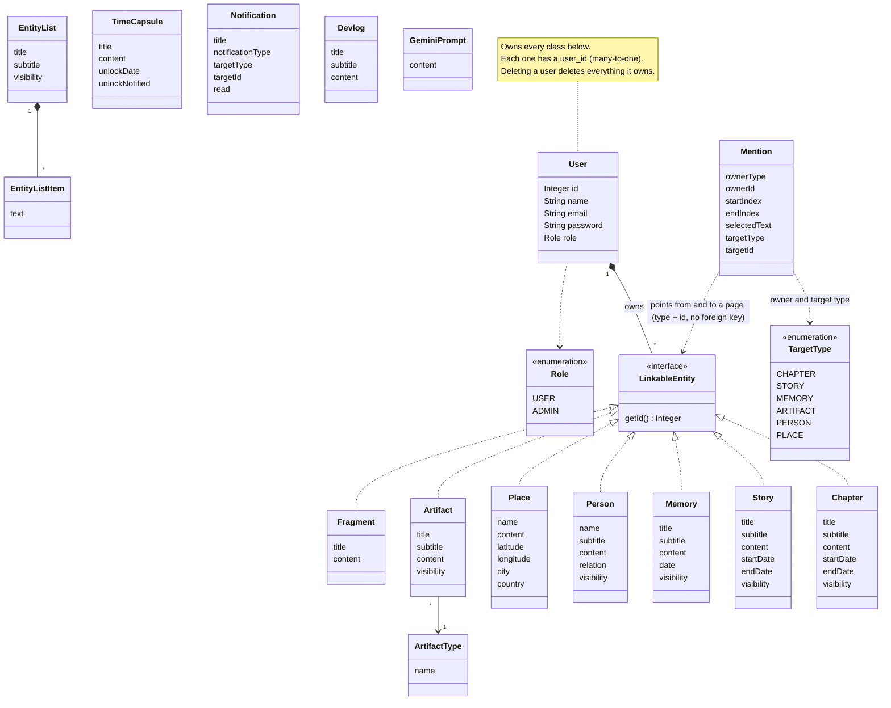

# Class diagram

This is a simplified view of the domain model: the JPA entities and how they relate. It shows the important fields, not every one.

## How to read it

- **User** owns everything else. Every entity has a `user_id` (many-to-one), and deleting a user deletes everything it owns. A user has a `Role` (`USER` or `ADMIN`).
- **Pages** (`Chapter`, `Story`, `Memory`, `Person`, `Place`, `Artifact`, `Fragment`) implement the `LinkableEntity` interface. They are the things a mention can link from and to.
- **Artifact** has an **ArtifactType**, a category the user makes up themselves (for example "Clothing").
- **EntityList** holds a list of **EntityListItem**s.
- **TimeCapsule** keeps its content hidden until `unlockDate`. `unlockNotified` makes sure the owner is only told once.
- **Notification** is created by the system (a new devlog, an unlocked time capsule). **Devlog** is written by an admin and read by everyone.
- **Mention** is the interesting one. It stores an *owner* (`ownerType` + `ownerId`) and a *target* (`targetType` + `targetId`), plus the highlighted text (`startIndex`, `endIndex`, `selectedText`). It has **no foreign keys** to the pages, because one mention can point at six different kinds of page and a foreign key can only point at one table. The service layer checks that both pages exist and belong to the user, and the generic DAO removes a page's mentions when the page is deleted.

## Diagram source

The diagram is written in [Mermaid](https://mermaid.js.org/), which GitHub renders directly:

